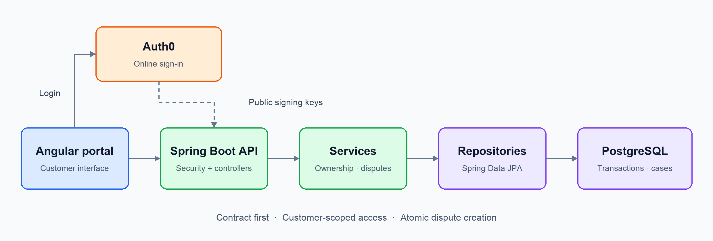

# Card Dispute Service


View transactions. Submit disputes. Track their timeline.

[🚀 Start](#quick-start) · [🧪 Test](#build-and-test) · [🏗️ Architecture](#architecture) · [⚙️ More options](#run-options)

## Prerequisites

| Run mode | You need |
| --- | --- |
| 🐳 Containers | Docker + Compose, or Podman + Compose provider; engine running |
| ☕ Local backend / tests | Java 25 + Maven 3.9.x installed |
| 🟢 Frontend development | Node.js 22, in the separate `card-dispute-portal` checkout |

Internet is required for downloads and Auth0 login. Ports: **8080** backend · **5432** database · **4200** frontend.

## Quick start

From the backend repository:

```bash
# First checkout only: copy and adjust your local settings
cp .env.example .env
docker compose up --build -d
```

Builds, tests and starts the backend + PostgreSQL with seeded assessment data. No manual database setup. The local `.env` is ignored by Git; `.env.example` contains runnable assessment defaults.

[Swagger UI](http://localhost:8080/swagger-ui.html) · [OpenAPI](http://localhost:8080/openapi.yaml) · [Health](http://localhost:8080/actuator/health)

```bash
curl --fail http://localhost:8080/actuator/health
docker compose logs -f card-dispute-service
```

Wait for health **UP**. Podman users substitute `podman compose`; execution was verified with Podman.

## Build and test

```bash
# Build, test, package and generate coverage
mvn clean verify

# Build the container image only; also runs backend tests
docker build -t card-dispute-service .
```

| Output | Location |
| --- | --- |
| 📦 Executable JAR | `target/card-dispute-service-0.0.1-SNAPSHOT.jar` |
| 🧪 Test results | `target/surefire-reports/` |
| 📊 Coverage | `target/site/jacoco/index.html` |

Regular tests use isolated H2 databases and local test JWTs—no running containers or Auth0 required.

## Architecture

[](docs/architecture.png)

| Concern | Design |
| --- | --- |
| 📜 Contract | [OpenAPI YAML](src/main/resources/openapi/openapi.yaml) → generated interfaces/DTOs; MapStruct maps responses |
| 🔐 Ownership | Verified JWT issuer/subject → customer → accounts → transactions → disputes |
| 💾 Data | Seeded mock transactions; Flyway migrations; Hibernate schema validation |
| 🔁 Safe retries | `Idempotency-Key`, database locks and uniqueness; at most one non-closed dispute per transaction; closed cases retain history |
| 🧩 Errors / evidence | Central Problem Details; Tika checks PDF/PNG/JPEG, matching MIME type, ≤ 5 MiB |

## Disputes after closure

A posted transaction can have another dispute only when every previous dispute is `CLOSED`. `RESOLVED`, `REJECTED` and all other non-closed statuses continue blocking another case. Closed cases retain their comments, events and evidence; the transaction response's `disputeId` points only to its non-closed case, if present.

The initial SQL migration `src/main/resources/db/migration/V1__create_schema.sql` enforces uniqueness for non-closed cases with a PostgreSQL partial unique index. Start with a fresh database after this schema change. H2 tests use the equivalent initial schema in `src/test/resources/db/h2-migration/V1__create_schema.sql`. Use a fresh idempotency key for a new case: replaying an old key still returns its original case, even after closure.

## Run options

<details>
<summary>🌐 Frontend and assessment login</summary>

With the backend running, execute this from the **frontend checkout**:

```bash
docker compose up --build -d
```

Open [the portal](http://localhost:4200). Nginx uses the backend's `card-dispute-service_default` network; start the backend first.

| Login | Value |
| --- | --- |
| Username | `shannonweir@capitecbank.co.za` |
| Password | `P@ssw0rdP@ssw0rd` |

Auth0 is hosted online. This login resolves to Shannon's seeded accounts. Missing/invalid tokens return **401**; unmapped users receive **403**.

For frontend development instead: `npm ci`, then `npm start`. Test with `npm test`; build with `npm run build`. Only one frontend should use port 4200. Development API requests use `localhost:4200/api/v1`; Angular proxies them to the backend on port 8080.

</details>

<details>
<summary>☕ Run from an IDE or Maven</summary>

Copy `.env.example` to `.env` once. Spring imports this file from the repository working directory for Maven/IDE runs. Stop the backend container first if it occupies port 8080:

```bash
docker compose stop card-dispute-service
docker compose up -d database
mvn spring-boot:run
```

Or run `CardDisputePortalServiceApplication` in your IDE. Use **Java 25**, **no active profile**, and the repository root as the working directory.

</details>

<details>
<summary>🧪 Optional PostgreSQL tests</summary>

Six concurrency tests are skipped by default. Provision a **disposable** database on port 55432: database, username and password all `dispute_tests`.

```bash
mvn clean verify -Dpostgres.tests=true \
  -Dtest.postgres.url=jdbc:postgresql://localhost:55432/dispute_tests \
  -Dtest.postgres.username=dispute_tests -Dtest.postgres.password=dispute_tests
```

These tests insert data. Use a separate database, not the application database.

</details>

<details>
<summary>⚙️ Configuration and contract changes</summary>

Deployment settings live in `.env`: database credentials/name, local JDBC URL, Auth0 issuer/audience, demo seed subjects and CORS origins. Start from [.env.example](.env.example), which includes every environment variable referenced by the backend configuration. Keep entries as unquoted `KEY=value` so both Compose and Spring's local properties import can read them. The file is excluded from Git and the image build.

[application.yml](src/main/resources/application.yml) keeps Spring settings and references these values; [test overrides](src/test/resources/application-test.yml) remain isolated. `DB_URL` connects Maven/IDE runs to `localhost:5432`; Compose overrides it to use the container hostname `database`. Changing `.env` values takes effect when Compose recreates the affected containers. PostgreSQL credentials are initialized with its data volume; editing `.env` does not change an existing database user's password.

For another Auth0 tenant, update the `.env` issuer/audience and demo subject mappings plus frontend settings; allow the frontend's callback/logout URLs and web origins in Auth0.

`AUTH0_DEMO_SUBJECT` and `AUTH0_SECOND_DEMO_SUBJECT` are used only by Flyway to initialize demo identity-to-customer mappings. Authentication validates JWTs; account access uses the persisted database mappings. The variables are not checked per request or used as a runtime user allowlist. In production, trusted customer onboarding would provision those mappings.

Change the OpenAPI contract first, then run `mvn generate-sources`. From the frontend checkout, run `npm run generate:api`. Generated Java code stays under `target/`.

</details>

<details>
<summary>🛑 Stop or reset the database</summary>

Stop while keeping data:

```bash
docker compose down
```

**Reset deletes ALL application database data:**

```bash
docker compose down --volumes
docker compose up --build -d
```

Stop the frontend container stack first if it uses the backend network; restart it afterward.

</details>

<details>
<summary>📌 Assessment scope</summary>

The container runs as a non-root user. Compose provides healthchecks, database readiness and persistent storage.

Staff processing, settlement, notifications, evidence downloads and malware scanning are outside scope. Tika detects formats; it is not an antivirus scanner. Credentials and HTTP endpoints are for local assessment; production needs managed secrets, HTTPS and operational monitoring.

</details>
